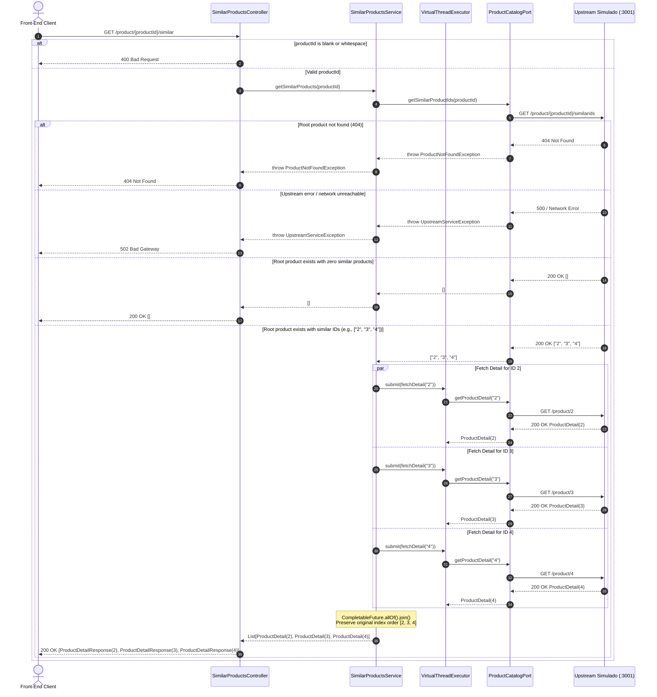

# Execution Flow: Similar Products Retrieval

This document outlines the detailed request/response lifecycle for retrieving similar products via `GET /product/{productId}/similar`.

---

## 1. Sequence Diagram



---

## 2. Key Execution Phases

### Phase 1: Input Validation
- The `SimilarProductsController` inspects `productId`.
- If the ID is empty or whitespace-only, `InvalidProductIdException` is thrown and mapped to `400 Bad Request`.

### Phase 2: Root Product Resolution
- `SimilarProductsService` invokes `ProductCatalogPort.getSimilarProductIds(productId)`.
- If the upstream service returns HTTP 404, `ProductNotFoundException` propagates to the controller, returning `404 Not Found`.
- If the upstream returns `[]`, the service immediately short-circuits and returns an empty list `[]`, avoiding unnecessary fan-out.

### Phase 3: Parallel Virtual-Thread Fan-Out
- Each similar product ID is mapped to a `CompletableFuture` executed asynchronously by `fanOutExecutor` (a dedicated Java 21 `Executors.newVirtualThreadPerTaskExecutor()`).
- Because tasks run on lightweight virtual threads, blocking network I/O does not pin carrier platform threads.
- `CompletableFuture.allOf(...)` coordinates concurrent joining across all dispatched tasks.

### Phase 4: Order Preservation
- Results are reassembled into the response list using the initial stream index order:
  ```java
  List<CompletableFuture<Optional<ProductDetail>>> futures = similarIds.stream()
      .map(id -> CompletableFuture.supplyAsync(() -> catalogPort.getProductDetail(id), fanOutExecutor))
      .toList();

  CompletableFuture.allOf(futures.toArray(new CompletableFuture[0])).join();

  return futures.stream()
      .map(CompletableFuture::join)
      .flatMap(Optional::stream)
      .toList();
  ```
- This guarantees that the ranking order returned by upstream `/similarids` is preserved deterministically in the final response.

---

## 3. Related Architecture Decisions

- [ADR-002: Framework Stack & Concurrency Model](../technical-decisions.md#adr-002-framework-stack--concurrency-model-spring-mvc-with-virtual-threads-over-webflux)
- [ADR-005: Root Product 404 vs Empty List Semantics](../technical-decisions.md#adr-005-root-product-404-vs-empty-list-semantics)
