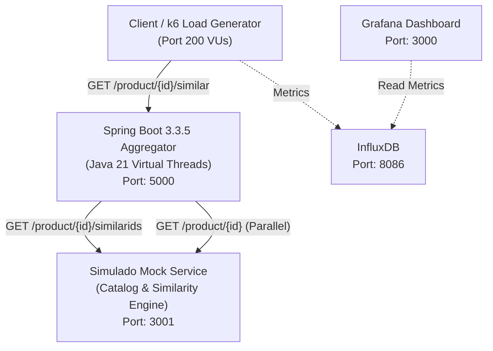

# System Topology & Service Boundaries

This document defines the physical and logical architecture, network topology, port allocations, and external dependencies of the Similar Products aggregation service.

---

## 1. Architecture Overview

The system acts as a high-concurrency aggregation gateway between front-end clients and the upstream Product Catalog service.

---

## 2. Port & Network Allocation

| Service | Port | Host Address | Description | Contract |
| :--- | :--- | :--- | :--- | :--- |
| **Similar Products Service** | `5000` | `http://localhost:5000` | Spring Boot Aggregation REST Service | [similarProducts.yaml](../similarProducts.yaml) |
| **Simulado Mock Service** | `3001` | `http://localhost:3001` | Upstream Catalog Mock Service | [existingApis.yaml](../existingApis.yaml) |
| **Grafana** | `3000` | `http://localhost:3000` | Real-time Performance Dashboard | `shared/k6/` |
| **InfluxDB** | `8086` | `http://localhost:8086` | Time-series Metrics Store | `docker-compose.yaml` |

---

## 3. Communication Protocols & Boundaries

### 1. Inbound REST API (`:5000`)
- **Protocol**: HTTP/1.1 JSON
- **Entrypoint**: `GET /product/{productId}/similar`
- **Concurrency**: Serviced by Java 21 Virtual Threads (`spring.threads.virtual.enabled=true`).
- **Health & Actuator**:
  - `GET http://localhost:5000/actuator/health`
  - `GET http://localhost:5000/actuator/metrics`

### 2. Outbound Upstream API (`:3001`)
- **Client**: Spring 6 `RestClient` backed by Apache HttpClient 5 with connection pooling:
  - Max total connections: 500
  - Max connections per route: 200
- **Fan-Out Model**: Asynchronous execution across a dedicated virtual-thread executor (`Executors.newVirtualThreadPerTaskExecutor()`).

---

## 4. Architectural Decisions Reference

- [ADR-001: Java 21 LTS](technical-decisions.md#adr-001-java-version)
- [ADR-002: Framework Stack & Concurrency Model (Spring MVC with Virtual Threads)](technical-decisions.md#adr-002-framework-stack--concurrency-model-spring-mvc-with-virtual-threads-over-webflux)
- [ADR-003: Graceful Degradation for Downstream Failures](technical-decisions.md#adr-003-graceful-degradation-for-downstream-partial-failures)
- [ADR-004: Strict Upstream Call Timeout](technical-decisions.md#adr-004-strict-upstream-call-timeout)
- [ADR-006: In-Memory Caching Strategy](technical-decisions.md#adr-006-in-memory-caching-strategy-with-caffeine)
