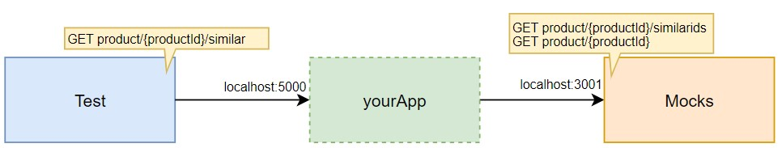

# Backend dev technical test
We want to offer a new feature to our customers showing similar products to the one they are currently seeing. To do this we agreed with our front-end applications to create a new REST API operation that will provide them the product detail of the similar products for a given one. [Here](./similarProducts.yaml) is the contract we agreed.

We already have an endpoint that provides the product Ids similar for a given one. We also have another endpoint that returns the product detail by product Id. [Here](./existingApis.yaml) is the documentation of the existing APIs.

**Create a Spring boot application that exposes the agreed REST API on port 5000.**



Note that _Test_ and _Mocks_ components are given, you must only implement _yourApp_.

## Testing and Self-evaluation
You can run the same test we will put through your application. You just need to have docker installed.

First of all, you may need to enable file sharing for the `shared` folder on your docker dashboard -> settings -> resources -> file sharing.

Then you can start the mocks and other needed infrastructure with the following command.
```
docker-compose up -d simulado influxdb grafana
```
Check that mocks are working with a sample request to [http://localhost:3001/product/1/similarids](http://localhost:3001/product/1/similarids).

To execute the test run:
```
docker-compose run --rm k6 run scripts/test.js
```
Browse [http://localhost:3000/d/Le2Ku9NMk/k6-performance-test](http://localhost:3000/d/Le2Ku9NMk/k6-performance-test) to view the results.

## Evaluation
The following topics will be considered:
- Code clarity and maintainability
- Performance
- Resilience

## Architecture & Engineering Standards
- **[System Topology & Boundaries](docs/topology.md)**: Ports, protocols, network diagrams, and service interactions.
- **[Architectural Decision Records (ADRs)](docs/technical-decisions.md)**:
  - [ADR-001: Java 21 LTS](docs/technical-decisions.md#adr-001-java-version)
  - [ADR-002: Framework Stack & Concurrency Model (Spring MVC + Virtual Threads)](docs/technical-decisions.md#adr-002-framework-stack--concurrency-model-spring-mvc-with-virtual-threads-over-webflux)
  - [ADR-003: Downstream Partial Failure Handling (Graceful Degradation)](docs/technical-decisions.md#adr-003-downstream-partial-failure-handling-graceful-degradation)
  - [ADR-004: Strict Upstream Call Timeout (2.5s)](docs/technical-decisions.md#adr-004-timeout-strategy-for-upstream-dependencies)
  - [ADR-005: Root Product 404 vs. Empty List Semantics](docs/technical-decisions.md#adr-005-root-product-404-vs-empty-list-semantics)
  - [ADR-006: In-Memory Caching Strategy (Caffeine)](docs/technical-decisions.md#adr-006-in-memory-caching-strategy-caffeine)
- **[Performance & Resilience Benchmark Report](docs/performance.md)**: Full k6 test metrics (200 constant VUs, 0% errors, 24.3ms avg latency).

